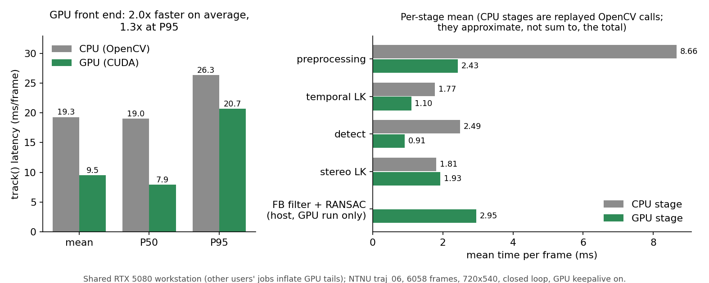
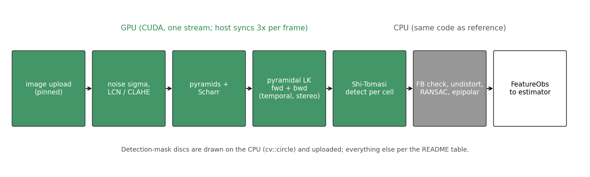
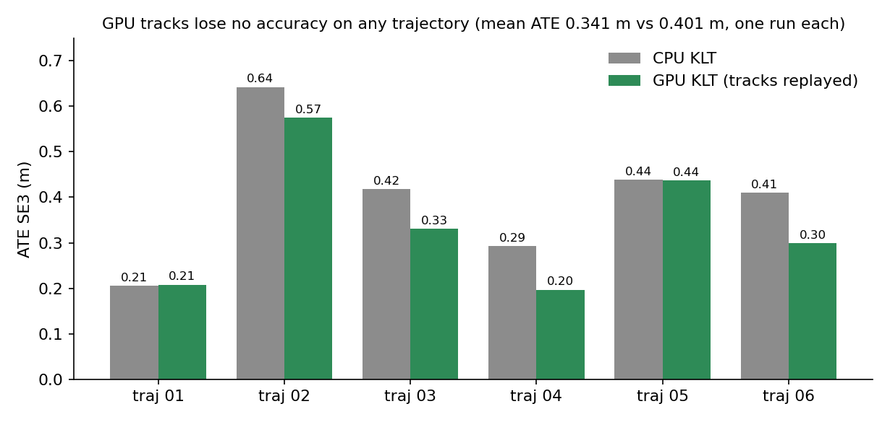

# uw-gpu-klt: CUDA port of the uw_ct_vio KLT stereo front end

`gpu_frontend::GpuKltStereoTracker` is a drop-in for `uw_ct_vio::KltStereoTracker` (same `KltConfig`,
`CameraModel`, `track(left, right, pred)` and `std::vector<FeatureObs>` output). It reproduces the algorithm
and OpenCV's numerics on the GPU; `uw_ct_vio/` (from uw-vio-dvl) is only read (the CPU reference is compiled from its source path).



*`track()` latency on NTNU traj_06 (6058 frames) on the shared RTX 5080 workstation (other users' jobs inflate GPU tails); the
CPU stage rows are replayed OpenCV calls and do not sum to the total. Not measured on Jetson Orin.*

## What runs where

| Stage | Where | Fidelity to the CPU tracker |
|---|---|---|
| image upload (pinned, one stream) | GPU | - |
| Immerkaer noise sigma (Sobel, median via radix sort, integer sums) | GPU | same value to 1e-9 (test) |
| LCN (15 px box, noise floor) | GPU | max 1 grey level, mean diff < 0.01 (test) |
| CLAHE (2x2 tiles, clip 1) for CLAHE-only and stereo | GPU | max 1 grey level, <0.1 % pixels differ (test) |
| pyramids (cv::pyrDown) + Scharr derivatives | GPU | bit exact (test) |
| pyramidal LK, fwd + bwd, temporal and stereo | GPU, one warp per point | mirrors cv::calcOpticalFlowPyrLK (fixed-point bilinear, minEig, stopping rules); median diff < 0.005 px (test) |
| Shi-Tomasi per grid cell (min-eig response, threshold, 3x3 NMS, mask, min distance, greedy) | GPU, one block per cell | eigenvalue map within 1e-4 relative of cv::cornerMinEigenVal on the cell ROI; same features (test) |
| FB check, NCC (optional), undistort, essential-matrix RANSAC, epipolar test | CPU (same code) | identical |
| discs of the detection mask | CPU (cv::circle) then uploaded | identical |



*Simplified stage overview (the actual per-frame order interleaves temporal LK, detection and stereo LK); see the table for
exact fidelity.*

Not implemented (constructor throws `std::invalid_argument`): `map_predict`, `reacquire`, `snr_sigma`,
`ncc_noise_aware`. `pred` is ignored. Capacity: 2048 features (throws beyond). Image size must equal the camera
model size and be divisible by `clahe_tiles`. Single-threaded use (one tracker, one thread).

Per frame the host synchronises three times (temporal results, detections, stereo results); no allocations after
construction (all device and pinned buffers are created in the constructor).

## CUDA architectures

`CMAKE_CUDA_ARCHITECTURES` defaults to `87;120`: sm_87 = Jetson Orin, sm_120 = RTX 5060 laptop / RTX 5080.
Both are compiled with nvcc 12.8 (real code for 87, real + PTX for 120). Only sm_120 has been run.

## Build and test

Needs a sibling checkout of [uw-vio-dvl](https://github.com/Blackcipher101/uw-vio-dvl) (the CPU reference tracker and the `FeatureObs` /
`KltConfig` types are compiled from `../uw-vio-dvl/uw_ct_vio`; override with `-DUWCT_DIR=`), GTSAM 4.2 installed
to a prefix (`-DGTSAM_PREFIX=`, default `../deps/gtsam-4.2.0`), OpenCV 4, CUDA 12.8 and, for the bench, ROS 2 Jazzy.

```bash
git clone https://github.com/Blackcipher101/uw-vio-dvl ../uw-vio-dvl
bash -lc 'source /opt/ros/jazzy/setup.bash && \
  cmake -S . -B build -DCMAKE_BUILD_TYPE=Release -DGTSAM_PREFIX=$HOME/deps/gtsam-4.2.0 \
        -DCMAKE_CUDA_COMPILER=/usr/local/cuda-12.8/bin/nvcc && \
  cmake --build build -j2'
LD_LIBRARY_PATH=$HOME/deps/gtsam-4.2.0/lib ctest --test-dir build --output-on-failure
```
(The bench target needs ROS 2; without it only the library and tests are built.)

## Benchmark

```bash
bench/run_bench.sh [--max-frames N] [--gpu-keepalive] [--open-loop] [--track-out F.uwtrk] [--no-cpu] [--no-cpu-stages]
```
`bench/run_bench.sh` takes the NTNU root from `$NTNU` (traj_06) and sets and `--lcn 2 --lcn-stereo 0`. Options:

* `--gpu-keepalive`: runs a one-warp spin kernel on a second stream so a laptop GPU does not drop to idle clocks
  between the short per-frame bursts (without it the laptop shows 3-5 ms GPU stages that are 0.1-0.5 ms at
  boost clocks; Jetson with `jetson_clocks` and desktop cards are not affected). Benchmark aid only.
* `--open-loop`: after every frame the GPU tracker is re-seeded with the CPU tracker's features, so the agreement
  numbers are one-frame agreement instead of chaotic closed-loop divergence (ids shift after the first
  borderline forward-backward decision).
* `--track-out`: writes the GPU features of every frame as a `UWTRK1` file (see below).
* CPU stage rows are measured by replaying the same OpenCV calls on the tracker's own frames and points
  (the tracker's internals are private), so they approximate, not partition, the CPU total.

`results/run_all.sh` produced the logs in `results/`.

## End-to-end ATE with GPU tracks

`results/ntnu06_gpu_klt.uwtrk` is a `UWTRK1` file (t = left header stamp). `run_bag --track-mode replace` replays
it instead of running the KLT tracker (see `results/` and the report for the exact command).

## Results on workstation1 (RTX 5080, shared machine with other users' jobs; 2026-11-04)

Front-end benchmark, NTNU traj_06, 6058 frames, `--lcn 2 --lcn-stereo 0 --gpu-keepalive`, closed loop:

| ms/frame | mean | P50 | P95 | P99 | max |
|---|---|---|---|---|---|
| CPU `track()` | 19.28 | 19.01 | 26.31 | 31.58 | 49.97 |
| GPU `track()` | 9.53 | 7.91 | 20.69 | 24.24 | 37.57 |

Speed-up 2.0x mean, 2.4x P50 (laptop, quiet period: 4.9x mean). The CPU-side forward-backward filter +
`findEssentialMat` RANSAC (2.95 ms mean on ws1, ~5.6 ms on the laptop) is now the largest single cost; GPU
tails are inflated by other users' load on the shared GPU/CPU. Not measured on Jetson Orin (sm_87 compiled,
never run).

End-to-end ATE, uw_ct_vio best config (h05) on all 6 NTNU 2023 trajectories, GPU tracks replayed with
`--track-file traj_XX.uwtrk --track-mode replace` vs the built-in CPU KLT (same binary, same flags):

| | traj_01 | traj_02 | traj_03 | traj_04 | traj_05 | traj_06 | mean ATE (m) | mean RPE (%) |
|---|---|---|---|---|---|---|---|---|
| CPU KLT (h05) | 0.206 | 0.642 | 0.418 | 0.293 | 0.438 | 0.410 | 0.401 | 6.75 |
| GPU KLT | 0.208 | 0.575 | 0.331 | 0.197 | 0.437 | 0.299 | 0.341 | 6.71 |

Reading: no accuracy loss on any trajectory. The GPU tracks are the same algorithm; they differ from the CPU
ones only through floating-point paths that flip borderline forward-backward decisions, so the lower mean is
NOT claimed as an improvement (one run per trajectory, no variance estimate).



*ATE per trajectory from the table above (NTNU 2023 subset-3, one run each, no variance estimate: the lower GPU mean is not claimed as an improvement).*

Regenerate the figures (needs matplotlib; inputs are the bench log and the run table, paths for our machine):
```bash
python3 bench/make_figures.py --bench-log <gpu_bench_ws1.log> --ate-tsv <ntnu_all.tsv>
```
