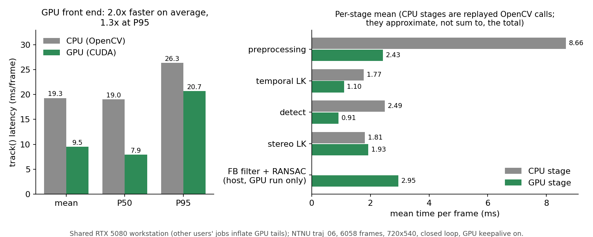
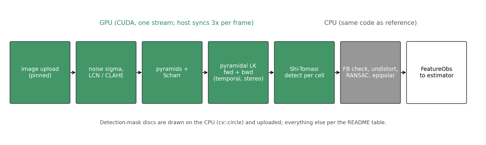

# Design: what runs where (details)

[Back to README](../README.md)

`gpu_frontend::GpuKltStereoTracker` is a drop-in for `uw_ct_vio::KltStereoTracker` (same `KltConfig`,
`CameraModel`, `track(left, right, pred)` and `std::vector<FeatureObs>` output). It reproduces the algorithm
and OpenCV's numerics on the GPU; `uw_ct_vio/` (from uw-vio-dvl) is only read (the CPU reference is compiled from its source path).

*`track()` latency on NTNU traj_06 (6058 frames) on the shared RTX 5080 workstation (other users' jobs inflate GPU tails); the
CPU stage rows are replayed OpenCV calls and do not sum to the total. Not measured on Jetson Orin.*

## What runs where

| Stage | Where | Fidelity to the CPU tracker |
|---|---|---|
| image upload (pinned, one stream) | GPU | - |
| Immerkaer noise sigma (Sobel, median via radix sort, integer sums) | GPU | same value to 1e-9 (test) |
| LCN (15 px box, noise floor) | GPU | max 1 grey level, mean diff < 0.01 (test) |
| CLAHE (2x2 tiles, clip 1) for CLAHE-only and stereo | GPU | max 1 grey level, <0.1 % pixels differ (test) |
| pyramids (cv::pyrDown) + Scharr derivatives | GPU | bit exact (test) |
| pyramidal LK, fwd + bwd, temporal and stereo | GPU, one warp per point | mirrors cv::calcOpticalFlowPyrLK (fixed-point bilinear, minEig, stopping rules); median diff < 0.005 px (test) |
| Shi-Tomasi per grid cell (min-eig response, threshold, 3x3 NMS, mask, min distance, greedy) | GPU, one block per cell | eigenvalue map within 1e-4 relative of cv::cornerMinEigenVal on the cell ROI; same features (test) |
| FB check, NCC (optional), undistort, essential-matrix RANSAC, epipolar test | CPU (same code) | identical |
| discs of the detection mask | CPU (cv::circle) then uploaded | identical |

*Simplified stage overview (the actual per-frame order interleaves temporal LK, detection and stereo LK); see the table for
exact fidelity.*

Not implemented (constructor throws `std::invalid_argument`): `map_predict`, `reacquire`, `snr_sigma`,
`ncc_noise_aware`. `pred` is ignored. Capacity: 2048 features (throws beyond). Image size must equal the camera
model size and be divisible by `clahe_tiles`. Single-threaded use (one tracker, one thread).

Per frame the host synchronises three times (temporal results, detections, stereo results); no allocations after
construction (all device and pinned buffers are created in the constructor).

## CUDA architectures

`CMAKE_CUDA_ARCHITECTURES` defaults to `87;120`: sm_87 = Jetson Orin, sm_120 = RTX 5060 laptop / RTX 5080.
Both are compiled with nvcc 12.8 (real code for 87, real + PTX for 120). Only sm_120 has been run.
